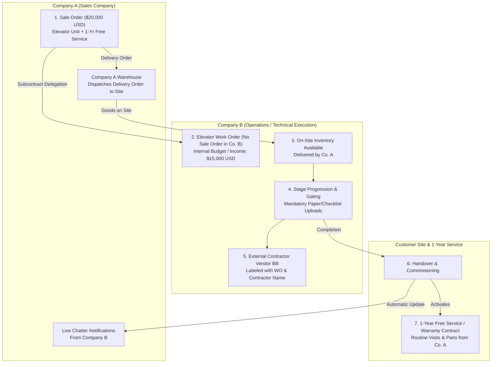

# Elevator Company Operations & Multi-Company Subcontracting (Odoo 19)

A specialized Odoo 19 enterprise module designed for elevator manufacturing, sales, and service companies operating under a multi-company structure.

---

## 🏢 Business Architecture & Multi-Company Structure

The system connects 3 companies seamlessly without redundant paperwork:



---

## ⚙️ Key Features Implemented

### 1. Sales-to-Subcontract Delegation (Company A ➔ Company B)
* **Full Package Sales**: Company A creates a Sale Order for the client (e.g. $20,000 USD covering the equipment, delivery, installation, and 1-year free warranty service).
* **Direct Subcontract Button**: Clicking **"Subcontract to Company B"** automatically creates the **Elevator Work Order** directly inside Company B:
  * Transfers an internal budget allocation (e.g. **$15,000 USD**) as internal revenue for Company B.
  * **No redundant customer sales order** is created in Company B.
  * Links customer site, unit serial tag, and delivery orders.

### 2. On-Site Inventory Coordination
* Technicians arriving on site have immediate visibility of **Company A's delivery orders** (`stock.picking`) delivered to the customer site.
* Materials consumed or parts replaced during installation and maintenance can be tracked with their source (*Site Inventory*, *Company A Central Storage*, or *Company B Van*).

### 3. Strict Stage Gating & Document Verification
Progression across the 6 installation stages requires uploading verification documents:
1. **1. Site Readiness & Shaft Prep**: Shaft Plumb Line & Power Supply Readiness Checklist.
2. **2. Guide Rails & Brackets**: Guide Rail Alignment & Pit Buffer Inspection Sheet.
3. **3. Cabin & Mechanical Assembly**: Car Sling, Counterweight & Door Assembly Sign-Off.
4. **4. Motor, Cables & Electrical Wiring**: Traction Motor & Control Cabinet Wiring Test Sheet.
5. **5. Safety Testing & Commissioning**: Certified Safety Drop Test, Governor & Brake Test Certificate.
6. **6. Handover & Completion**: Customer Signed Acceptance & Handover Certificate.

> **Gating Enforcement:** Technicians and contractors are blocked by the system from advancing to the next stage if the mandatory checklist or paper scan is not uploaded.

### 4. Contractor Milestone Billing (Vendor Bills)
* Supports both **Internal Technicians (Company B staff)** and **External Subcontractors**.
* For external contractors, clicking **"Generate Contractor Vendor Bill"**:
  * Creates an Odoo Vendor Bill (`account.move` with `move_type='in_invoice'`).
  * Explicit Label: `WO: EWO/2026/0001 - Stage: [Stage Name] - Contractor: [Contractor Name]`.
  * Verified against stage document approvals.

### 5. Return Notification to Company A
* Once the final handover stage is approved and the work order is marked done:
  * **Company A's Sale Order chatter** is automatically updated with full commissioning details.
  * The elevator installation status changes to **Installed & Operational**.
  * The Elevator Unit asset status updates to **Operational / Active**.

### 6. 1-Year Free Service / Warranty Contract
* Commissioning automatically activates the **1-Year Free Warranty Service Contract** (`elevator.contract`).
* Scheduled preventive maintenance inspection visits are automatically calculated and generated in Company B.
* For repairs or routine visits, technicians log spare parts directly from Company A storage.

### 7. Paid Repairs & Spare Parts Replacement Workflow (e.g. Elevator Buttons)
* **Customer Call & Sale Order in Company A**:
  * Customer has an issue (e.g. broken floor push button, COP button panel, worn door sensor).
  * Company A creates a **Sale Order** for the spare parts and technician labor.
  * User selects **Elevator Subcontract Job** with category **"Paid Repair / Spare Parts Replacement"** and picks the customer's existing elevator asset.
* **Subcontract Dispatch to Company B**:
  * Clicking **"Dispatch to Company B (Work Order)"** creates a Repair Work Order (`order_type = 'repair'`).
  * **Auto-Extracted Parts**: Spare parts from Company A's SO lines are automatically populated into the Work Order's **"Materials Consumed On-Site"** tab so technicians know exactly what parts to install.
  * Dispatched delivery orders from Company A are linked to the site.
* **3-Step Repair Stages & Customer Sign-Off**:
  1. *1. Dispatch & Site Diagnosis*
  2. *2. Parts Replacement & Operational Test* (Requires photo of replaced button/part & functional test)
  3. *3. Customer Sign-off & Completion* (Requires Customer Signed Work Completion & Satisfaction Sheet)
* **Live Return to Company A**:
  * When Company B completes the repair and uploads the signed sheet, Company A's repair Sale Order chatter is instantly notified with full details.

---

## 🔒 Security & Odoo 19 Compliance

* **Odoo 19 3-Layer Security Hierarchy**: Implemented via `ir.module.category` ➔ `res.groups.privilege` ➔ `res.groups`.
* **No `users` field on `res.groups`**: Follows Odoo 19 architecture and grants admin privileges via `base.group_system.implied_ids`.
* **Multi-Company Record Rules**: Company A sales managers can track work orders originating from their sales orders while Company B operations teams see all assigned work orders.

---

## 📂 Module Structure

```
elevator_management/
├── __init__.py
├── __manifest__.py
├── README.md
├── security/
│   ├── elevator_security.xml        # Odoo 19 3-layer security groups
│   ├── elevator_rules.xml           # Multi-company record rules
│   └── ir.model.access.csv          # Access control list (ACL)
├── data/
│   ├── ir_sequence_data.xml         # Auto-numbering sequences
│   └── elevator_stage_data.xml      # Default stages with gating rules
├── models/
│   ├── __init__.py
│   ├── elevator_site.py             # Installation site & shaft dimensions
│   ├── elevator_unit.py             # Elevator asset & serial tracking
│   ├── elevator_work_order_stage.py # Workflow stages with upload requirements
│   ├── elevator_work_order_document.py # Uploaded papers, photos & approvals
│   ├── elevator_work_order.py       # Core work order, gating, contractor billing
│   ├── elevator_contract.py         # 1-year warranty & AMC maintenance contracts
│   ├── sale_order.py                # Sale order subcontracting delegation
│   └── stock_picking.py             # Link delivery orders to site & work order
└── views/
    ├── elevator_site_views.xml
    ├── elevator_unit_views.xml
    ├── elevator_work_order_stage_views.xml
    ├── elevator_work_order_views.xml
    ├── elevator_contract_views.xml
    ├── sale_order_views.xml
    ├── stock_picking_views.xml
    └── elevator_menus.xml
```
